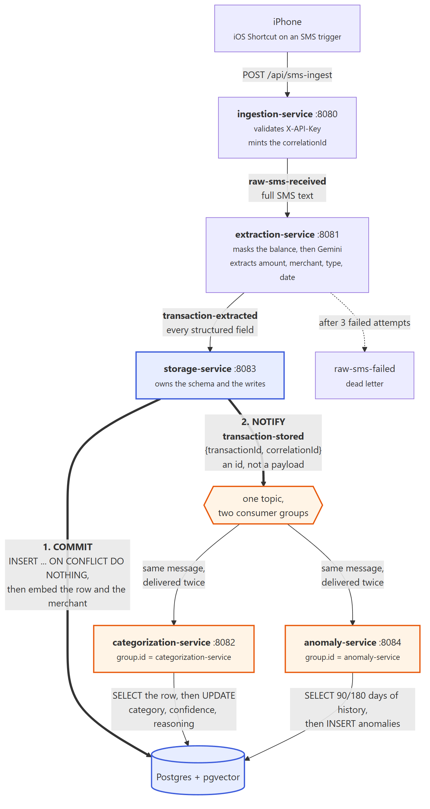
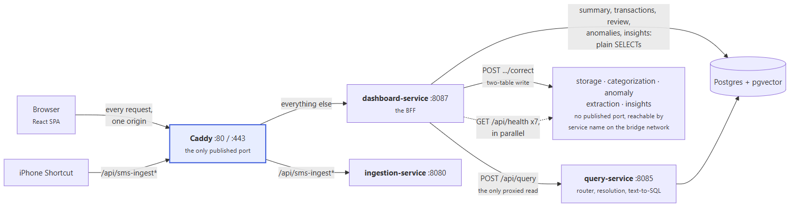
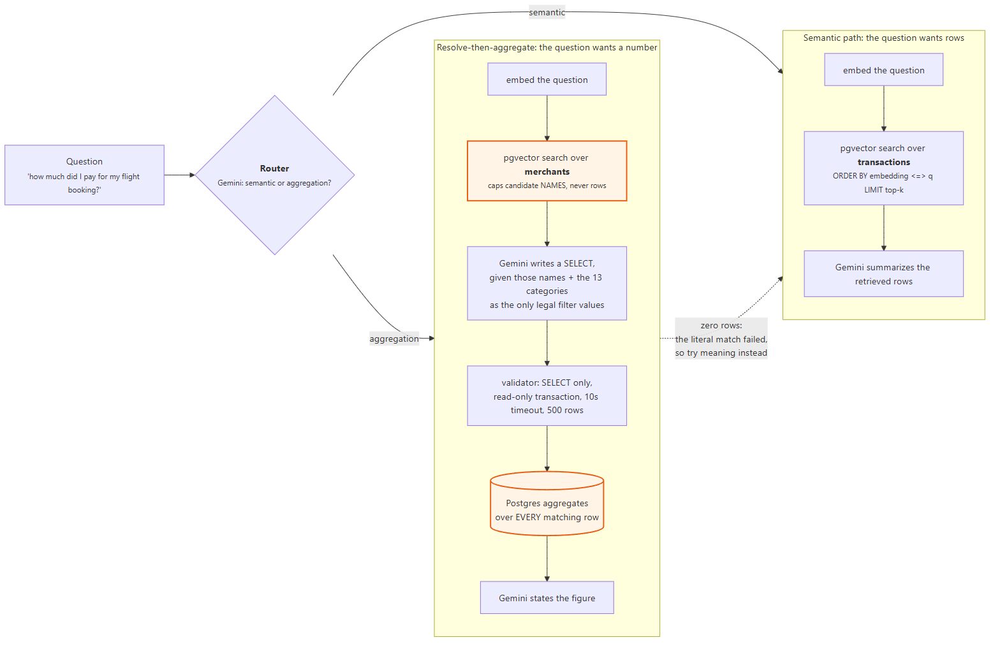

# SpendSense AI

SpendSense turns the bank SMS already arriving on a phone into a categorized, queryable
spending history. A message lands, an iOS Shortcut forwards it to an HTTP endpoint, and a Kafka
pipeline takes it from there: a language model pulls out the amount, merchant, direction and
date, the row is committed to Postgres, and two independent services then categorize the
spending and check it against anomaly rules. A React dashboard reads it all back through a
single backend-for-frontend, and a chat page answers questions in plain English — including
questions that need arithmetic over the whole table rather than a handful of retrieved rows.

The reason it works this way is that there is no better channel. UPI apps — GPay, PhonePe,
Paytm — expose no transaction API to an individual, and the bank portals that do offer one
(Axis, Paytm Payments Bank) require a registered business to apply. Bank email alerts are
inconsistent and frequently absent. The transaction SMS is the one notification that arrives
reliably for nearly every payment, from every bank, on every account. Reading it is the other
half of the problem: iOS does not let a third-party app read SMS or notifications, and it is not
going to, so there is no non-jailbreak path from "the message arrived" to "my software saw it"
except an iOS Shortcuts automation that fires on an incoming message and POSTs the text
somewhere. That constraint is the whole shape of the system. Everything downstream is a
consequence of starting from an unstructured string that a bank wrote for a human to read.

## Architecture

Eight Spring Boot services in a Gradle multi-module build, plus a React frontend, Kafka,
Postgres with pgvector, and Caddy in front of all of it. The services never call each other's
code; the pipeline communicates entirely through Kafka topics and the serving path entirely
through HTTP.



An SMS arrives at `ingestion-service`, which checks an API key, mints a `correlationId` that
will follow this message through every service, and publishes the raw text to
`raw-sms-received`. `extraction-service` masks the account balance out of the text — that is a
privacy measure, not a parsing one, since the free Gemini tier may use submitted content to
improve the product — and asks the model for the structured fields. The result goes to
`transaction-extracted`, and three failed attempts send the message to `raw-sms-failed` instead
of losing it.

`storage-service` is where the interesting part happens. It writes the row to Postgres and
commits, generating embeddings for the transaction and for the merchant name, and only then
publishes `transaction-stored` — a notification carrying an id and a correlation id, and nothing
else. `categorization-service` and `anomaly-service` both consume that one topic under
different consumer group ids, so both receive every message, read the full row from Postgres
themselves, and write their results back. Neither waits for the other.



On the serving side the browser knows exactly one origin. Caddy is the only container with a
published port and splits one hostname by path: `/api/sms-ingest*` reaches the pipeline's inlet
and everything else reaches `dashboard-service`, the BFF. The BFF runs its own SELECTs for the
dashboard, the transaction list, the review queue, the anomalies and the insights, and proxies
exactly two things — a chat question to `query-service`, and a category correction to
`storage-service` — because in both cases the real logic lives there and a second copy would
drift. Caddy authenticates nothing: the API key on the ingest path is checked by
`ingestion-service` itself, so the gate stays with the service that owns it.



A question is classified first, and then answered by one of two mechanisms. Questions that want
particular rows back go to similarity search over the transactions. Questions that want a number
go down a path worth describing in full, below.

The full write-up, including the Kafka topic table and the schema, is in
[docs/architecture.md](docs/architecture.md).

## Measured results

Three suites — extraction, categorization, query — each scored on two case sets, against a
non-LLM baseline, with every failure classified. `eval.ps1` runs all of it and writes per-case
detail to `eval/results/`; the method is in [eval/README.md](eval/README.md).

The split matters more than any individual number. `eval/cases/dev/` holds the cases that were
written while the prompts were being built, and failures in those cases were used to change
prompts — the Priya Sharma miss produced the "Needs Manual Categorization" wording, the flight
question produced the "categories are broad" paragraph in the SQL prompt. **Those scores are
contaminated and are an upper bound.** `eval/cases/test/` was written after the prompts were
frozen, from thirteen banks the dev set never mentions, templates the dev banks also send but
dev does not cover, merchants dev never names, and colloquial re-phrasings of questions dev asks
plainly. No failure in the held-out set has ever been used to change a prompt. Tune on dev,
score on test, never the reverse.

### Baselines

Every score needs something to beat, so each suite also runs against a deterministic non-LLM
implementation: a regex reader for extraction, a keyword lookup table for categorization, and a
"does the question contain *how much* / *total* / *how many*" heuristic for routing. These are
complete and cost nothing to re-run.

| | dev | held-out test |
|---|---|---|
| Extraction, per-field accuracy | 95.9% | 82.5% |
| Extraction, exact records | 79.4% | **37.5%** |
| Extraction, non-transaction rejection | 90% | 100% |
| Categorization accuracy | 77.4% | 81.2% |
| Categorization, confident-and-wrong | 22.6% | 18.8% |
| Query routing | 92.3% | 80% |
| Query aggregation | 0% | 0% |

Two of these deserve saying out loud rather than burying.

**The routing heuristic is competitive.** 92.3% on dev and 80% held out, from one regular
expression. The router is a model call that mostly reproduces what a keyword list already does,
and on this evidence the case for it resting on accuracy alone is weak. What it buys is
graceful behaviour on phrasings the keyword list has never seen — but that is a claim about
robustness, not a measured win, and the held-out set is where it should be argued.

**The keyword categorizer is closer than it looks.** 77-81% against a model that manages 87% on
dev. The gap is real but it is not the order-of-magnitude difference the architecture implies.
What the table does not show is the shape of the errors: the lookup table is *confidently* wrong
19-23% of the time, because a lookup table has no notion of confidence, so every one of its
mistakes goes straight into the user's totals unchallenged. The model's confident-mistake rate
is a fraction of that. The argument for the model is calibration, not accuracy.

**The regex extractor collapses on held-out data**, and that is the most informative number in
the table: 79.4% exact records on the templates it was written against, 37.5% on templates it
has not seen. A rule-based reader is a list of the formats someone already looked at. Every new
bank is a new rule, and the collapse is what maintaining it would feel like.

**The baseline cannot answer an aggregation question at all**, which is why that row is zero by
construction rather than by failure. That is the argument for the SQL path in one line.

### Model scores

The held-out column is the one to read.

| | held-out model | held-out baseline | dev model |
|---|---|---|---|
| Extraction, per-field accuracy | **98.1%** (1 run) | 82.5% | 100% (5 runs) |
| Extraction, exact records | **90.6%** (1 run) | 37.5% | 100% (5 runs) |
| Extraction, non-transaction rejection | **90%** (1 run) | 100% | 100% (5 runs) |
| Categorization accuracy | **86.7%** (84.4-87.5, 4 runs) | 81.2% | 87.1% |
| Categorization, confidently wrong | **8%** (7.1-10.7, 4 runs) | 18.8% | 4% |
| Query routing | **97.8%** (93.3-100, 3 runs) | 80% | 100% |
| Query aggregation | **77.8%** (75-83.3, 3 runs) | 0% | 90-100% |
| Query resolution | **100%** (3 runs) | 0% | 100% |

**The held-out scores are not materially lower than dev, and that is the result the split was
built to produce.** Extraction gives up 9.4 points of exact records moving to thirteen banks it
has never seen; the regex baseline gives up 41.9 over the same move. Categorization and query do
not drop at all. On this evidence the prompts generalise, rather than having been fitted to the
cases they were debugged against — which is a claim no dev-set score could have supported, however
high.

One number moved the wrong way and is worth stating plainly: **non-transaction rejection falls
from 100% on dev to 90% held out.** That is by construction. The held-out set contains
non-transactions that name a merchant and an amount — an OTP for a purchase, a courier notice, a
pre-debit mandate warning — and one of them, a Federal Bank mandate notice, was read as an
₹18,420 payment to HDFC Life. A warning that money *will* leave is not money leaving, and this
is the failure most likely to put a phantom row in front of a user.

Dev extraction is five independent runs with zero variation across 44 cases and five fields. It
is also the *contaminated* set, so a perfect score there is close to uninformative on its own;
its value is as the ceiling the held-out number is compared against. The dev categorization and
query figures predate the person-to-person prompt fix and have not been re-measured.

### Variance

The model is not deterministic at `temperature` 0, and the suite runs each eval five times for
that reason, reporting mean, min and max plus the list of cases whose verdict changed between
runs — those matter more than the average. Extraction on dev did not move at all across five
runs. Earlier single runs of categorization and query did: the same credit from an individual
came back as `Needs Manual Categorization` twice and `Income` once, and the flight question
answered ₹14,650 once and ₹20,250 twice, which is the whole difference between 10/10 and 9/10 on
aggregation. One run is a sample, not a measurement.

Repeated on the held-out sets, the instability turns out to be concentrated in very few cases
rather than spread thinly. Across four categorization runs **exactly one case of 32 changed its
verdict**, and across three query runs **one of 15** — every other case answered the same way
every time.

Both unstable cases are worth naming, because each marks a real gap rather than noise.
`t-ajio` is a ₹2,199 **credit** from a clothing retailer, a refund: answered `Shopping` three
times and `Income` once. The prompt says `Income` is money from an organisation, and a retailer
is an organisation, so a refund satisfies the rule as written — but a refund is not earnings, it
reverses a purchase, and the category should stay what the money was spent on. The prompt needs
a refund clause. `t-largest-single` routed to retrieval once and SQL twice, and only SQL can
answer "what was my single biggest payment"; a routing mistake there is also an aggregation
failure, which is why the taxonomy gives it two classes.

Query aggregation is the least stable metric at 75-83.3%, and it fails on *different questions*
between runs: two in one run, two others in the next, with only `t-getting-around` failing in
both. The mean hides that the set of failing questions is itself unstable, which is worse than
the mean suggests.

Three figures above are still a single run (held-out extraction), and that suite is at least the
one with five dev runs of evidence that it does not move. The constraint is the free tier's 500
requests per day per model against a five-run suite's ~1,300 calls, not the method — the suite
takes `-Runs 5` and reports mean, min and max whenever there is quota to spend on it. Worth
recording that **the first run of each suite flattered it**: held-out categorization came in at
87.5% and query aggregation at 83.3%, and both were the top of their range, not the middle.

### Error taxonomy

Failures are classified rather than counted, with the classes fixed before any run. Extraction
separates a missed transaction from a false positive from each wrong field, and keeps
`merchant-hallucinated` apart from `merchant` — inventing a payee for a bank template that names
none is a different defect from mis-spelling one that does. Query separates `routing-error`,
`sql-overmatch`, `sql-undermatch`, `sql-no-rows` and `resolution-miss`, so a right answer found
the wrong way is visible.

Categorization separates **ambiguous** from **clearly wrong**, and only the second is a defect.
Each case declares, in the case file and before any run, the categories a careful human could
also defend: Uber as `Travel` rather than `Transport`, a gym membership as `Subscriptions`
rather than `Health`, a bus booking as either. Declaring them up front is the point — classified
afterwards, "ambiguous" becomes a label for whatever the model happened to get wrong.

## Design decisions

### Store first, then notify

The obvious pipeline publishes the extracted transaction as a fat event and lets each
downstream service consume it. This one commits the row first and then publishes an id.

The difference shows up in three places. Data safety comes first: categorization is a second
model call that can time out or return nonsense, and none of that can lose a transaction when
the transaction is already in Postgres with `category = NULL`. Recovery comes second: a service
that was down reads the row as it is *now* when it catches up, rather than replaying a payload
that went stale while it was offline. And the third is that the two downstream services are not
in a chain — neither is the other's input, so neither can block or corrupt the other.

The cost is a window where a transaction exists without a category, which the UI has to handle
rather than pretend away. That is a smaller problem than the ones it avoids.

### Fan-out by consumer group, not by topic

`transaction-stored` has one producer and two consumers, and the entire mechanism that makes
both of them see every message is that `categorization-service` and `anomaly-service` set
different `group.id` values. Kafka tracks an offset per group, so two groups each get the full
stream.

This is worth stating explicitly because getting it wrong is silent. With the same group id,
Kafka treats the two services as two instances of one application and divides the partitions
between them. Roughly half the transactions would be categorized and the other half checked for
anomalies, there would be no error in any log, and the symptom — "some transactions never get a
category" — looks like a model failure rather than a configuration one.

### Resolve-then-aggregate, and why plain RAG is wrong for a total

"How much did I pay for my flight booking?" is two questions wearing one coat. It is fuzzy about
*which* rows — a flight is not a category, because `Travel` also covers trains, buses and
hotels — and completely exact about *what* to compute, namely a sum over every one of them.

Text-to-SQL alone cannot do it, because the model has to invent the filter value. Asked this
question with only the schema in front of it, it wrote `category ILIKE '%flight%'` and returned
nothing, confidently.

Retrieval-augmented generation alone cannot do it either, and this is the failure worth dwelling
on. RAG fetches the `top-k` nearest rows and asks the model to add them up. With `top-k = 5` and
eleven matching transactions, the model sees five and sums five, and the answer it returns is a
plausible number with no indication that six rows were never shown to it. Raising `top-k` moves
the cliff; it does not remove it. A silently truncated total is worse than an error, because an
error can be noticed.

So the two halves are given to the tools that can actually do them. The question is embedded and
searched against a `merchants` table — one row per distinct merchant name — rather than against
transactions. That search returns candidate *names*, and its `LIMIT` therefore caps how many
names the SQL prompt is shown, never how many rows get summed. Those names plus the thirteen
closed-list categories go into the SQL prompt as the only legal filter values, with the
instruction that several merchants may match one question. Postgres then does the arithmetic,
over every matching row. "Flight booking" resolves to MakeMyTrip, and the total is a total.

When the generated SQL returns zero rows, the question is retried over the embeddings and the
response says so — `method: rag`, `fallbackFrom: sql`, with the attempted SQL attached — rather
than reporting that the transaction does not exist.

### Confidence decides what a human sees

Categorization returns a category, a confidence and a one-sentence justification, and all three
are written in the same `UPDATE` so they can never disagree about which decision the sentence
explains. A confidence below the threshold, or the category `Needs Manual Categorization`, sets
`needs_review` and the row appears in the review queue with its reasoning quoted and attributed
— as a claim to be judged rather than as the application asserting a fact.

The failure this is aimed at is not the model being wrong. It is the model being wrong
*confidently*, because that is the case nothing flags and the number lands in the user's totals
unchallenged. That is why the eval reports calibration separately from accuracy: "how often is
it wrong" and "when it is wrong, did it tell us" are different questions, and only the second
one tells you whether the review queue is doing its job.

### Corrections feed back into the prompt

A correction is not just an `UPDATE`. It writes a row to a `corrections` table, and
`categorization-service` reads the ten most recent corrections on every categorization and
injects them into the system prompt as few-shot examples. Fixing "Priya Sharma" once teaches the
categorizer about payments from individuals for every transaction after it, without retraining,
fine-tuning, or a rules engine that someone has to maintain.

The limitation is honest: ten examples, newest first, is a small and crude memory, and it does
not generalize beyond what the examples resemble. It is the cheapest thing that closes the loop
at all.

## Problems found and fixed

These are the three worth writing down, because in each case the symptom pointed somewhere other
than the cause.

**ivfflat silently dropped correct answers.** The obvious thing to do with a pgvector column is
index it, and `ivfflat` is the index everyone reaches for. It is approximate: a query probes one
bucket of `lists` and never looks at the rest. On a small table that is not a speed/accuracy
trade-off, it is just missing data. Measured here, a `LIMIT 10` similarity search over five
merchants returned three of them and dropped the one the question was about. Nothing errored,
nothing logged, and the query path simply reported that the flight booking did not exist. Both
embedding indexes were removed. Exact search over this table is sub-millisecond, and the index
is worth reconsidering only on a large, populated table with `lists ≈ rows/1000` — and only
after re-measuring recall, which is the step that was skipped the first time.

**A nested `<springProfile>` discarded the root logger.** Containers came up, reported healthy,
and produced not one line of output after the Spring banner. The configuration looked right:
a `<root>` element with a `<springProfile>` inside it switching the file appender off in
production. Spring Boot forbids nesting `<springProfile>` inside `<root>`, `<logger>` or
`<appender>` — and it does not ignore the nested element, it discards the entire enclosing one.
The root logger ended up with no appenders at all. The only evidence anywhere was a single
`|-WARN` line from logback's own status output, which is itself printed only because the
configuration produced a warning. The fix was to declare the root logger once per profile
instead. The health endpoint kept answering throughout, which is exactly why the containers
looked fine: `/api/health` does not log.

**Rebuilding a jar under a running JVM.** This one cost an hour and the diagnosis was wrong for
most of it. `POST /api/dashboard/query` began hanging forever — no response, no timeout, nothing
in the logs. The investigation went through the JDK HTTP client's streaming request path, the
Gemini call, Postgres `max_connections` and three thread dumps. The actual cause was in the
service's stderr file the whole time: `ClassNotFoundException:
ch.qos.logback.classic.spi.ThrowableProxy`. A Spring Boot jar is read lazily, so running
`./gradlew build` while the services are up replaces the archive under a live JVM, and that
process can no longer load any class it has not already touched. The request dies inside Tomcat,
the error logging cannot load *its* classes either, the socket processor dies without writing a
response, and the client waits forever with nothing written anywhere it was looking. `/api/health`
kept working because its classes were already loaded, which made the service look alive. The
lesson that generalizes: when a process answers one endpoint and hangs on every other, suspect
the class loader, and read stderr before reading thread dumps.

## Running it locally

You need Docker, a JDK 17 and a Gemini API key from Google AI Studio. Node 18+ is needed only to
run the frontend dev server or re-render the diagrams.

Copy `.env.example` to `.env` and fill in `GEMINI_API_KEY`, `INGESTION_API_KEY` and
`POSTGRES_PASSWORD`. Every other variable has a working local default, and `.env` is gitignored
— the key must never reach a Dockerfile, where it would survive in an image layer even if a
later line deleted it.

The whole platform runs in containers:

```powershell
docker compose -f docker-compose.prod.yml --env-file .env up -d --build
```

Twelve containers come up: eight services, Kafka, Zookeeper, Postgres with pgvector, and Caddy.
Startup is ordered with `depends_on: condition: service_healthy`, so Kafka waits for a healthy
Zookeeper and everything that reads the database waits for `storage-service`, which owns the
schema. The memory limits total about 3.6GB; measured idle footprint is 1.7GB, which is what
makes a 4GB ARM VM a sensible target.

Only Caddy publishes a port. Send a test SMS through the front door:

```powershell
$body = @{
    rawText    = "Rs.450.00 debited from A/c XX1234 on 12-09-26 to VPA swiggy@ybl (UPI Ref 625412345678). -HDFC Bank"
    senderId   = "AX-HDFCBK"
    receivedAt = (Get-Date).ToUniversalTime().ToString("o")
} | ConvertTo-Json

Invoke-RestMethod -Method Post -Uri http://localhost/api/sms-ingest `
    -Headers @{ "X-API-Key" = "<your INGESTION_API_KEY>" } `
    -ContentType "application/json" -Body $body
```

The response carries the `correlationId`. About thirty seconds later the transaction is stored,
categorized and checked for anomalies, and that one id traces the whole path:

```powershell
docker compose -f docker-compose.prod.yml logs --no-log-prefix | Select-String <correlationId>
```

`GET http://localhost/api/dashboard/summary` will show it. For frontend development,
`docker-compose.yml` runs only the infrastructure so the services can be started from an IDE
against it, and `cd frontend; npm install; npm run dev` serves the UI on port 3000 — a port
pinned with `strictPort`, because it is the exact origin the BFF's CORS configuration allows and
a silent fallback to 3001 would turn every request into a CORS failure.

## What isn't built, and why

There is **no authentication and no concept of a user**. The whole system assumes one person's
transactions in one database. Adding real multi-tenancy is not a feature bolted on later: every
query, every embedding search and every aggregate would need a tenant predicate, and getting one
of them wrong leaks someone's spending to someone else. A single-user system that says so is
more honest than a multi-user one that has not been audited for it.

There is **no multi-currency support**. Amounts are stored as `NUMERIC(14,2)` with a `currency`
column that is always `INR`, and every total sums across rows without consulting it. Doing this
properly means storing a rate with each transaction and deciding what "total spend" even means
across currencies — a question with no single right answer — and nothing in the problem this
solves needs it.

**Merchant embeddings are per name, not per transaction.** The `merchants` table holds one row
per distinct merchant string, embedded on the name alone. That is what makes resolve-then-
aggregate work, since it caps candidate names rather than rows. It also means resolution knows
nothing about what a merchant *is* beyond its name: "Blue Tokai" resolves for "coffee" because
the name is suggestive, and a shop called "KSR Traders" that happens to sell coffee will not
resolve for anything. Fixing that means enriching merchants with a description or a learned
category centroid, which is a real piece of work rather than a tweak.

Deployment is one Oracle Cloud ARM VM running `docker compose`, chosen because the whole thing
then costs nothing and stays a single command. The trade is one host with no redundancy, which
is the right call for a portfolio project and the wrong one for anything real.
