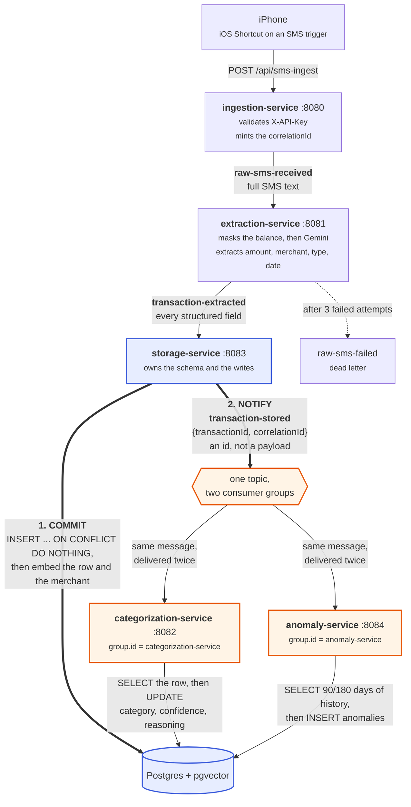
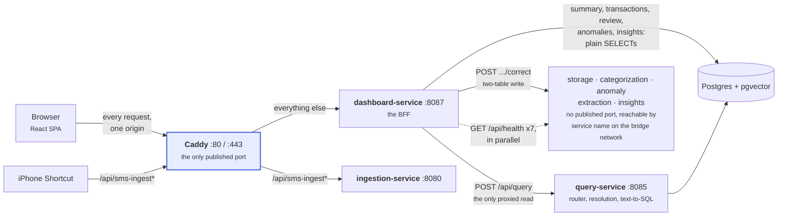
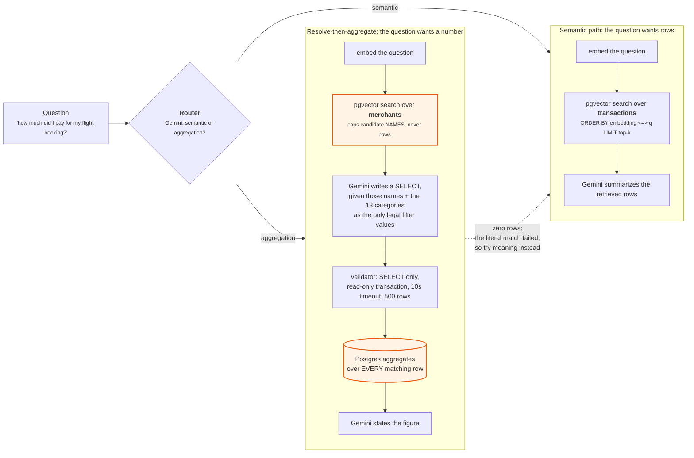

# SpendSense AI — architecture

Three diagrams, because the system has three distinct shapes: an asynchronous pipeline that
turns an SMS into a stored transaction, a synchronous serving path that answers a browser, and
a decision inside the query service that decides how a question gets answered.

The two decisions worth understanding before reading any code are **store-then-notify** and the
**Kafka fan-out**. Both are in the first diagram.

The diagrams below are the source. GitHub renders Mermaid natively, so this page needs nothing
else; `docs/render-diagrams.ps1` renders the same blocks to `docs/images/*.png` for the README
and for anywhere else that does not. Each block names its own PNG with a `%% slug:` comment, so
editing a diagram here and re-running that script is the whole update.

---

## 1. The pipeline — SMS to stored, categorized transaction

Asynchronous. Every hop is a Kafka topic, and nothing in this flow blocks on anything
downstream of it.



### Store-then-notify

The thick pair of edges out of storage-service is the whole pattern. The row is committed
**first**; only then does a notification go out, and that notification carries an id rather than
the data. Three things follow from it.

The data is safe before any model has an opinion about it. Categorization is a second Gemini
call that can fail, time out or come back with nonsense; none of that can lose a transaction,
because the transaction is already in Postgres with `category = NULL`.

The downstream services are not in a chain. They both read the row themselves, so neither waits
for the other and neither can corrupt the other's input.

A service that is down catches up. The notification sits in Kafka with the consumer group's
offset where it left it, and when the service restarts it reads the row as it is now — not as
it was when the message was published. A fat event would have gone stale; an id cannot.

### The fan-out

`transaction-stored` has exactly one producer and two consumers, and those two consumers use
**different `group.id` values**. That is the entire mechanism, and getting it wrong is silent:
with the same group id Kafka would treat them as two instances of one application and split the
partitions between them, so roughly half of all transactions would be categorized and the other
half checked for anomalies, with no error anywhere. Different group ids means each group tracks
its own offset and each receives every message.

---

## 2. The serving path — browser to answer

Synchronous, and deliberately narrow: the browser knows about exactly one origin.



Caddy splits one hostname by path: `/api/sms-ingest*` reaches the pipeline's inlet, everything
else reaches the BFF. One origin for the browser, one certificate to renew, one port open on
the host. Caddy authenticates nothing — the API key is checked by ingestion-service, so the gate
stays with the service that owns it rather than being duplicated in proxy config.

Only two BFF endpoints proxy, and for the same reason both times: the real logic lives
elsewhere and a second implementation would drift. `POST /api/dashboard/query` goes to
query-service, which owns the router and the SQL generation. `POST /api/dashboard/review/{id}/correct`
goes to storage-service, which owns the two-table write that records the correction
categorization-service later reads back as a few-shot example. Everything else is a SELECT the
BFF runs itself; forwarding a plain SELECT would add a network hop and a second thing that can
be down, for nothing.

---

## 3. Inside a question — the query decision path

One question, two very different mechanisms, and a classifier choosing between them.



### Why the two halves are split

"How much did I pay for my flight booking?" is fuzzy about *which* rows and exact about *what*
to compute. Neither path alone can serve it.

Text-to-SQL alone invents filter values. Asked this question without help it wrote
`category ILIKE '%flight%'`, which matches nothing, because a flight is stored as `Travel`
alongside trains and buses.

Plain RAG alone truncates. It retrieves `top-k` rows and asks the model to add them up, so it
cannot see an eleventh matching transaction. Raising `top-k` moves the cliff rather than
removing it, and a wrong total is indistinguishable from a right one.

So embeddings resolve and SQL aggregates. The similarity search runs over the **merchants**
table, one row per distinct merchant name, not over transactions. Its `LIMIT` therefore caps how
many candidate *names* the SQL prompt is shown; the SQL that follows sums every row those names
match. That is the distinction the whole design turns on, and it is why the two highlighted
boxes above are the ones to read.

Zero rows from the generated SQL falls back to the semantic path, flagged in the response as
`fallbackFrom: sql` with the attempted SQL attached, rather than telling the user the
transaction does not exist.

### A note on ivfflat

Neither embedding column has an index, deliberately. `ivfflat` is approximate: it probes one
bucket of `lists` per query, and at small row counts it omits real matches. Measured here, a
`LIMIT 10` search over five merchants returned three and dropped the correct one. Exact search
is sub-millisecond at this scale. The index is worth re-adding only on a large, populated table,
with `lists ≈ rows/1000`, and only after re-checking recall.

---

## Observability across all of it

Every service logs one JSON object per line with the same seven fields — timestamp, service,
correlationId, eventId, level, message, logger. ingestion-service mints the `correlationId` and
it rides every Kafka event and every proxied HTTP call, so

```powershell
docker compose -f docker-compose.prod.yml logs --no-log-prefix | Select-String <correlationId>
```

reconstructs the full path of one SMS across every service that touched it, in order. The
plumbing lives in one shared `common` module rather than being copied eight times: a filter for
HTTP requests, a Spring Kafka `RecordInterceptor` for listeners, the log format, and
`/api/health`. A trace is only useful if its shape is identical everywhere, and eight
hand-maintained copies of a log format is exactly the thing that drifts.
